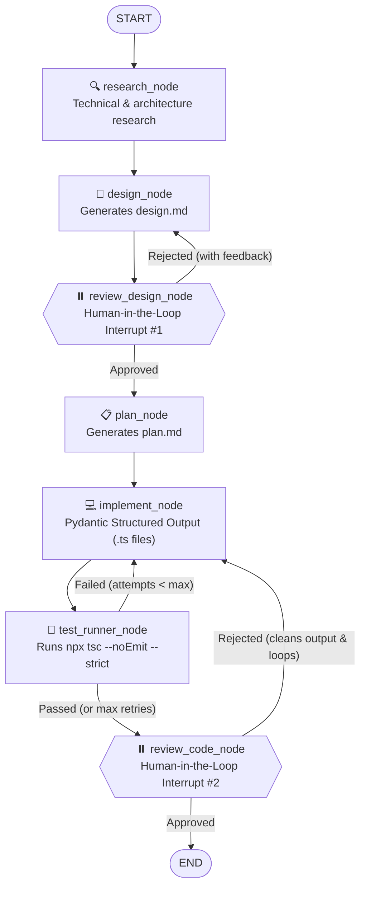

# LangGraph Agentic Workflows & Autonomous SDLC Pipeline

A hands-on engineering repository exploring stateful multi-agent orchestration with **Python**, **LangGraph**, **Pydantic**, and **Ollama / OpenAI** — culminating in a full-cycle autonomous software development pipeline (**Research → Design → Human Review → Plan → Implement → Compiler Test → Code Review**).

---

## 🏗️ Capstone Architecture: Autonomous SDLC Pipeline



---

## ✨ Key Engineering Highlights

- **Self-Healing Code Generation Loops:** Executes automated test and compiler checks (`pytest` and `tsc --noEmit --strict`) via isolated subprocesses, feeding `stdout`/`stderr` diagnostics back into the LLM to autonomously fix bugs.
- **Human-in-the-Loop (HITL) Approval Gates:** Uses LangGraph `interrupt()` and `Command(resume=...)` to pause execution before critical transitions, allowing human reviewers to approve artifacts or inject revision feedback.
- **Persistent State Checkpointing:** Powered by `SqliteSaver` (`langgraph-checkpoint-sqlite`), enabling workflows to pause, survive process restarts, inspect historical state snapshots, and resume via `thread_id`.
- **Deterministic Structured Outputs & Dynamic Tool Binding:** Uses **Pydantic** schemas (`with_structured_output`) to guarantee valid multi-file code generation and dynamic per-turn tool binding to reduce token usage and prevent out-of-order tool execution.
- **Environment-Agnostic Model Layer (`config.py`):** Seamlessly switches between zero-cost local inference via **Ollama** (`qwen2.5-coder:3b` / `qwen2.5:3b`) for development and cloud frontier models (**OpenAI GPT-4o**, **Claude**, **Gemini**) for production.

---

## 📂 Repository Structure

```text
├── config.py                       # Environment-based LLM provider switcher (Ollama / OpenAI)
├── requirements.txt                # Python dependencies
├── module_01/
│   └── hello_graph.py              # StateGraph basics, TypedDict, InputState, sequential nodes
├── module_02/
│   └── state_nodes.py              # Validation, conditional LLM invocation, and file I/O
├── module_03/
│   └── conditional_edges.py        # Conditional routing and bounded retry loops
├── module_04/
│   ├── retry_loop.py               # Self-healing code generation loop with pytest verification
│   └── test_solution.py            # Automated unit test suite for generated code
├── module_05/
│   └── human_in_loop.py            # Human-in-the-loop pause/resume with interrupt() & MemorySaver
├── module_06/
│   └── sqlite_checkpoint.py        # Cross-process state persistence & history via SqliteSaver
├── module_07/
│   └── tool_calling.py             # ReAct agent with @tool, ToolNode, and dynamic tool binding
├── module_08/
│   └── subgraphs.py                # Parallel multi-agent subgraphs (Fan-Out / Fan-In)
└── capstone/                       # Full Autonomous Dev-Cycle Pipeline
    ├── state.py                    # DevCycleState & InputState schemas
    ├── graph.py                    # StateGraph assembly and conditional routing logic
    ├── run.py                      # Interactive CLI runner with SQLite persistence
    └── nodes/
        ├── research.py             # Technical research node
        ├── design.py               # System architecture generator (design.md)
        ├── plan.py                 # Step-by-step implementation planner (plan.md)
        ├── implement.py            # Multi-file TypeScript generator (Pydantic structured output)
        ├── test_runner.py          # Automated TypeScript strict compiler verification
        └── review.py               # Human review interrupt gates & artifact cleanup
```

---

## 🚀 Getting Started

### 1. Prerequisites

- **Python 3.11+**
- **Node.js / npx** (for TypeScript compiler verification in Module 7 & Capstone)
- **Ollama** (for local LLM execution): [https://ollama.com](https://ollama.com)

```powershell
# Pull local models
ollama pull qwen2.5-coder:3b
ollama pull qwen2.5:3b
```

### 2. Installation

```powershell
# Create and activate virtual environment (Windows PowerShell)
python -m venv .venv
.\.venv\Scripts\Activate.ps1

# Install dependencies
python -m pip install --upgrade pip
pip install -r requirements.txt
```

### 3. Configuration (`.env`)

Create a `.env` file in the project root:

```env
# Local Development (Free via Ollama)
ENV=development
OLLAMA_MODEL=qwen2.5-coder:3b

# Production (Optional)
# ENV=production
# OPENAI_API_KEY=sk-...
```

---

## 🧪 Running the Modules & Capstone

Run any module from the project root using `python -m`:

```powershell
# Verify LLM connection
python config.py

# Run individual learning modules
python -m module_01.hello_graph
python -m module_02.state_nodes
python -m module_03.conditional_edges
python -m module_04.retry_loop
python -m module_05.human_in_loop
python -m module_06.sqlite_checkpoint
python -m module_07.tool_calling
python -m module_08.subgraphs

# Run the Full Capstone Pipeline
python -m capstone.run
```
